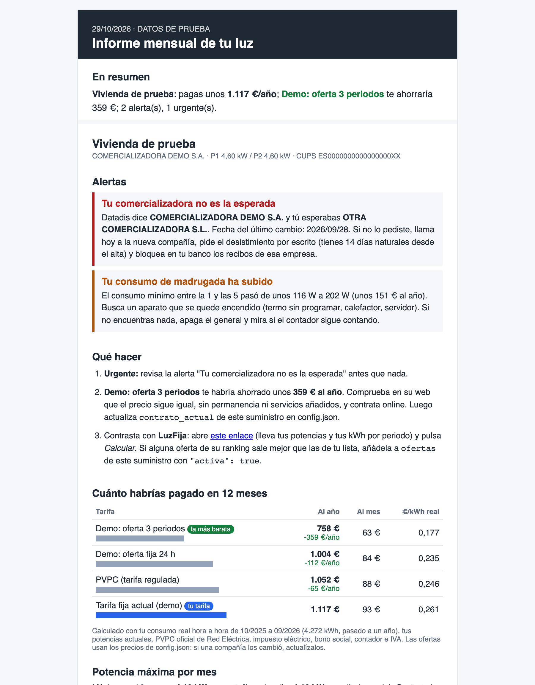

<div align="center">

# ⚡ Luz monitor

### A monthly check of your Spanish electricity bill that tells you, in plain language, whether you're overpaying and what changed without you asking.

[](#run-it)
[](https://datadis.es)
[-FDB813?style=flat-square)](https://www.ree.es)
[](#run-it)
[](LICENSE)

<br>



</div>

---

## What it does

Each month it downloads your hourly consumption from Datadis, prices it against the regulated tariff (PVPC, from Red Eléctrica), your current contract and the offers you list, and sends one report:

- **What each option would have cost** over the last 12 months, so you can see whether a different tariff beats yours and by how much.
- **The contracted power you actually need**, from your real peaks, in case you're paying for more.
- **Alerts for anything that changed on its own**: a different supplier, a change in contracted power, estimated instead of real readings, rising overnight consumption, or a renewal coming up.

Everything runs on the Python standard library. Passwords live in the macOS Keychain, never in a file.

## How it works

```
Datadis (your hourly kWh)  ─┐
PVPC prices (Red Eléctrica) ─┤
your contract + offers      ─┼─►  price 12 months on each tariff  ─►  report + alerts  ─►  email
contracted-power peaks      ─┘
```

## Run it

Try it with made-up data first (needs internet for PVPC prices):

```bash
cp config.example.json config.json
python3 luzgas.py --demo --sin-correo --abrir
```

With your data:

1. Create an account at [datadis.es](https://datadis.es).
2. Fill in `config.json`: NIF/NIE, CUPS (on your bill), your prices and the offers to compare.
3. `./guardar_contrasena.sh luzgas-datadis YOUR_NIF "Datadis"`
4. `python3 luzgas.py`

For email, store a Gmail app password with `./guardar_contrasena.sh luzgas-smtp you@gmail.com "Gmail"`, set `"metodo": "smtp"` in the `email` block, and schedule it with `./instalar.sh`. `config.json`, the cache and the reports are git-ignored.

The report and code comments are in Spanish.

---

<div align="center">
<sub>Built by <a href="https://github.com/diego-salomon">Diego Salomón</a>. · <a href="https://www.linkedin.com/in/diegosalomon">LinkedIn</a></sub>
</div>
